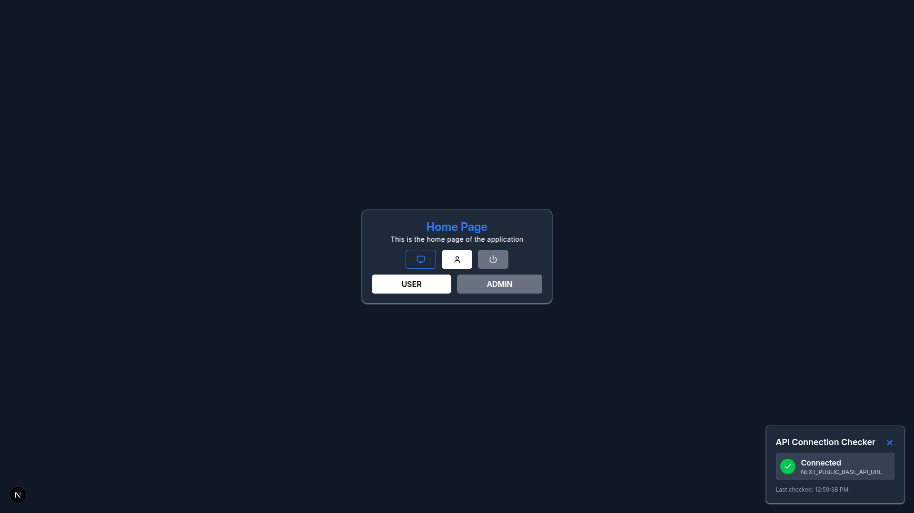
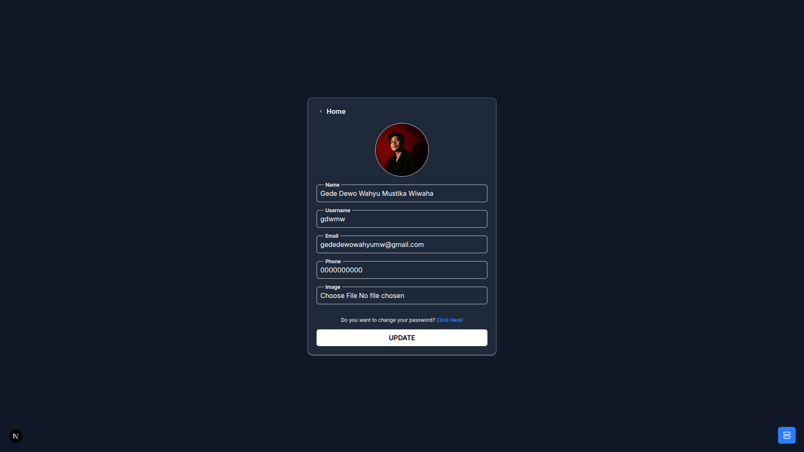
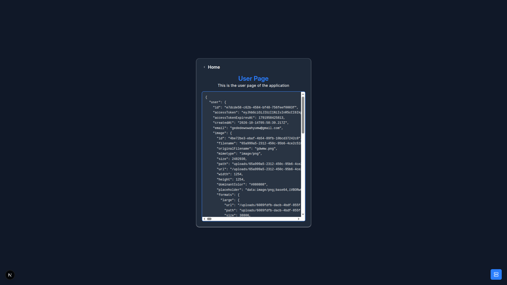
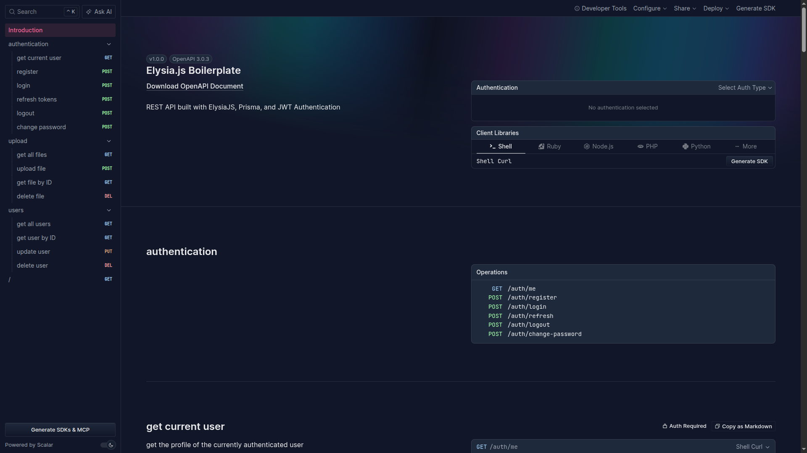
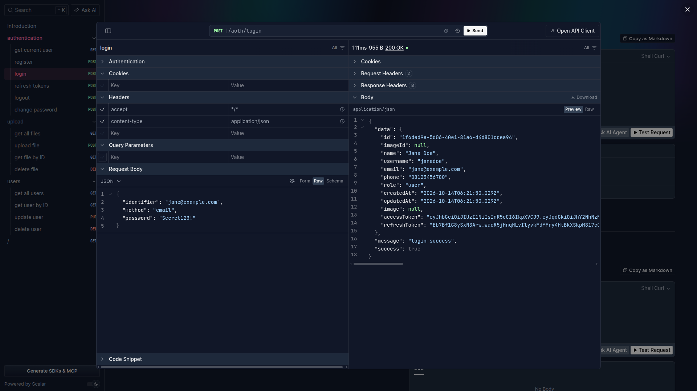

# 🚀 Fullstack Boilerplate (Turborepo + Next.js + Elysia.js)

Boilerplate by [Gede Dewo Wahyu M.W](https://github.com/gdwmw)


---

## 📖 Description

This monorepo is a fullstack starter kit based on Turborepo, consisting of:

- 🖥️ `apps/next`: frontend application using Next.js
- ⚙️ `apps/elysia`: REST API using Elysia.js + Prisma

---

## ⚙️ Prerequisites

Make sure the following are installed:

- 🟢 Node.js
- 📦 pnpm
- ⚡ Bun
- 🐘 PostgreSQL
- 🔴 Redis

---

## 🚀 Quick Start

1. **Clone repository**

```bash
git clone https://github.com/gdwmw/Fullstack-Boilerplate.git
cd Fullstack-Boilerplate
```

1. **Install dependencies**

```bash
pnpm install
```

1. **Setup environment variables**

```bash
pnpm cpenv
```

1. **Configure `.env`**

Update at least:

- `apps/elysia/.env`
- `apps/next/.env`

1. **Ensure services are running**

- 🐘 PostgreSQL must be active (`DATABASE_URL`)
- 🔴 Redis must be active (`REDIS_URL`)

1. **Generate Prisma Client and run migrations**

```bash
pnpm generate
pnpm migrate
```

1. **Run development mode**

```bash
pnpm dev
```

1. **Access the application**

- 🌐 Frontend: [http://localhost:3000](http://localhost:3000)
- 🔗 API: [http://localhost:1337](http://localhost:1337)
- 📄 Swagger: [http://localhost:1337/swagger](http://localhost:1337/swagger)

---

## 📁 Folder Structure

```text
.
├── apps
│   ├── next        # Next.js frontend
│   └── elysia      # Elysia.js backend + Prisma
├── packages        # Shared packages/config across apps
└── turbo.json      # Turborepo configuration
```

---

## 📜 Important Scripts

- ▶️ `pnpm dev` - run all apps in development mode
- 🏗️ `pnpm build` - build all apps/packages
- 🌐 `pnpm prod:start:next` - run Next.js production server directly
- ⚙️ `pnpm prod:start:elysia` - run Elysia.js production server directly
- ⚙️ `pnpm generate` - generate Prisma client
- 🗄️ `pnpm migrate` - run Prisma migrations
- 🧽 `pnpm format` - run workspace format task
- 🧹 `pnpm lint` - lint the entire workspace
- 🎨 `pnpm prettier` - format codebase
- 🔍 `pnpm check-types` - TypeScript type-check

---

## 🚢 Production Run Recommendation

For production, use Turborepo for build orchestration, then run each app directly (not through Turborepo runtime task).

1. **Build all apps/packages**

```bash
pnpm build
```

1. **Run each app process directly**

```bash
pnpm prod:start:next
pnpm prod:start:elysia
```

---

## 🧾 Commit Guideline

This project uses Commitizen (`pnpm commit`).

---

## 🤝 Contribution

1. Fork repository
2. Create branch (`feat/your-feature`)
3. Run checks
4. Commit & PR

---

## ❓ Q&A / Help

Include:

- Context
- Error message
- Reproduction steps

---

## ⚖️ License

MIT License
